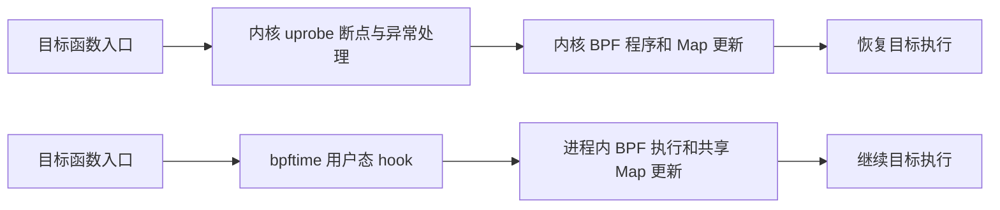

# Aya、bpftrace 与 bpftime 的 uprobe 性能实验报告

实验批次：`20261013-174015`，2026 年 10 月 13 日。原始数据目录：[../results/20261013-174015/](../results/20261013-174015/)。

## 1. 主要结论

在本次单线程、固定 CPU、函数入口计数测试中，**bpftime 的每次调用耗时最低，Aya 与 bpftrace 接近**。

| 方案 | 每次调用耗时中位数 | 相比基线额外开销 | 吞吐量 | 相比基线减速倍数 |
| --- | ---: | ---: | ---: | ---: |
| baseline | 13.94 ns | — | 7174.26 万次/秒 | 1.00× |
| Aya | 2566.89 ns | 2552.95 ns | 38.96 万次/秒 | 184.16× |
| bpftrace | 2623.19 ns | 2609.25 ns | 38.12 万次/秒 | 188.19× |
| bpftime | 976.26 ns | 962.32 ns | 102.43 万次/秒 | 70.04× |

- bpftime 相对 Aya：每次调用耗时减少 **61.97%**，吞吐量为其 **2.63 倍**。
- bpftime 相对 bpftrace：每次调用耗时减少 **62.78%**，吞吐量为其 **2.69 倍**。
- Aya 相对 bpftrace：每次调用少 **56.30 ns**，耗时减少 **2.15%**。

以上倍数根据总耗时中位数计算。如果先扣除基线，再比较额外开销，Aya/bpftime 为 **2.65×**，bpftrace/bpftime 为 **2.71×**。两种口径应分别表述。

本实验支持“此机器、此版本、此计数负载下，bpftime 的热循环开销明显较低”。它没有单独测量内核切换、hook、Map 或 JIT 的成本，不能据此把全部差值归因于某一个环节，也不能推导真实业务整体有同等加速。

## 2. 实验对象与环境

三者处于不同的软件层级：Aya 是 eBPF 开发框架，bpftrace 是追踪语言和工具，bpftime 是用户态 eBPF 运行时。本实验比较三个完整方案，而非编程语言本身的性能。

| 分组 | 加载与执行方式 | 每次触发的工作 |
| --- | --- | --- |
| baseline | 直接执行 C 目标 | 仅执行目标函数 |
| Aya | Aya 加载 Rust eBPF，挂载内核 uprobe | 更新 per-CPU hash 中的计数 |
| bpftrace | bpftrace 编译脚本，挂载内核 uprobe | `@hits[0] = count()` |
| bpftime | bpftrace 加载 syscall-server；目标加载 agent，执行用户态 hook | 同一条 `@hits[0] = count()` |

环境来自本次保存的 [environment.json](../results/20261013-174015/environment.json)，代码版本信息则来自分析时的仓库文件，二者不能混为同一时刻的完整快照。

| 项目 | 记录 |
| --- | --- |
| CPU 型号 | Intel Xeon Gold 6126 CPU @ 2.60GHz |
| 架构 | x86_64 |
| Linux | 5.4.0-216-generic，Ubuntu 内核构建 |
| 进程允许的逻辑 CPU 数 | 48 |
| 目标绑定 CPU | 逻辑 CPU 0 |
| GCC | Ubuntu GCC 9.4.0 |
| bpftrace | v0.9.4 |
| Aya / aya-ebpf | 当前 Cargo.lock 分别固定为 0.14.0 / 0.2.1 |
| Rust 编译器 | 本次环境记录未获取成功：sudo 环境找不到 `rustc`；不代表程序没有编译成功 |
| bpftime | 使用 `/home/wangyiwei/.bpftime/` 下已安装的运行库；本次未归档其版本、构建参数和二进制哈希 |
| JIT 配置 | runner 请求使用 JIT，并移除 `BPFTIME_DISABLE_JIT`；日志未明确记录实际 JIT 后端 |

当前本地 bpftime 源码 HEAD 为 `8da867d541f8322aa7bc56c05727769c2aa0622b`，仅作为后续追溯线索，不能证明本次安装库必定由该提交构建。内核 BPF JIT 的启用状态也未归档。

`cpuinfo` 中 CPU 0 的瞬时频率约为 1000 MHz，这不是整个测量期间的实际工作频率。型号中的 2.60 GHz 同样不能当作本次固定运行频率。

## 3. 实验设计

### 3.1 目标函数

目标源码为 [target.c](../target.c)，编译方式见 [build.sh](../build.sh)：

```bash
gcc -O2 -g -Wall -Wextra -Werror -fno-lto -fno-pie -no-pie \
  bench/target.c -o bench/build/target
```

`bench_add(a, b)` 返回 `a + b`，使用 `noinline`、`noclone` 和编译器内存屏障保留函数调用。函数内放置 16 个 NOP，为用户态 hook 提供足够指令空间；四组使用同一份目标，因此 baseline 也包含这些 NOP。

对本次结果目录内保存的 `target` 反汇编，确认函数包含 `endbr64`、16 个 NOP、加法和返回。目标不是一个可以被优化掉的空循环，但也不是典型业务函数。

### 3.2 探针负载与公平性

三个探针方案都只统计入口调用次数，不读取参数、不抓栈、不在每次调用时打印日志，也不持续传输事件。

Aya 使用 4096 个最大条目的 `PerCpuHashMap<u64, u64>`，固定键为 0：查找成功时原地加一，首次访问时插入 1。bpftime 的七份 handler 快照确认 `@hits` 为 `map_type=5`，即 per-CPU hash，键和值均为 8 字节、最大条目数为 4096，与 Aya 的数据形状一致。

这是**计数语义一致**的比较，不保证编译后的 BPF 指令完全相同，也不保证内核与用户态 Map 的内部实现相同。bpftrace 内核组使用同一计数表达式，但本次没有归档该组的实际内核 Map 信息和加载后的指令。

bpftime 组沿用 bpftrace 作为编译、加载和读取结果的工具。syscall-server 与目标 agent 通过每轮独立的共享内存协作；探针在目标进程内执行，计数不需要逐次向 server 发请求。该模式的组件分工和二进制重写方式见 [bpftime 官方设计说明](https://eunomia.dev/bpftime/documents/how-it-works/)。

### 3.3 单轮流程

1. 启动对应 tracer。Aya 等待挂载成功后的 `READY`；内核 bpftrace 等待 `BEGIN` 输出；bpftime 则通过 `bpftimetool export` 确认目标事件已启用且关联有效 BPF 程序，避免旧版 bpftrace 的 `BEGIN` 自身探针问题。
2. 就绪后额外等待 0.2 秒，让启动工作结束。
3. 启动新目标进程，将其绑定到逻辑 CPU 0。bpftime agent 在目标启动时加载、安装 hook。
4. 先调用目标函数 **100,000 次**预热，不计时。
5. 用 `CLOCK_MONOTONIC_RAW` 在循环前后各读一次时钟，测量 **1,000,000 次**调用。循环内不读时钟、不输出、不分配内存。
6. 输出计时结果及 checksum；目标结束后向 tracer 发送 SIGINT，读取最终计数。
7. 验证计数为 **1,100,000**，checksum 为 **505,000,550,000**，通过后才收录结果。

整个实验执行 7 轮，每轮四组串行运行，使用随机种子 42 打乱组别顺序，共 28 次测量。随机化缓解时间顺序偏差，但不保证完全均衡：本批次 Aya 在第 3–6 轮都先运行。

目标进程固定 CPU；tracer 没有指定独立 CPU，CPU 0 也没有被隔离为专用核心。固定 affinity 不等于排除了调度、中断、SMT 邻居或其他任务干扰。

### 3.4 指标定义

令第 i 轮该组计时循环耗时为 `T_i`，调用数为 `N=1,000,000`：

```text
每轮 ns/call = T_i / N
汇总耗时 = 7 个 ns/call 的中位数
额外开销 = 该组汇总耗时 − baseline 汇总耗时
减速倍数 = 该组汇总耗时 / baseline 汇总耗时
吞吐量 = 1,000,000,000 / 该组汇总耗时
```

额外开销采用“两个中位数相减”，并非先逐轮相减再取中位数。该指标是循环和函数调用的摊销墙钟耗时，包含期间可能发生的抢占；不是单次调用延迟的 p50/p99，也不是独立测出的 BPF 执行时间。

编译、加载、挂载、agent 初始化、启动时 JIT、预热、结束输出及卸载均不在计时区间内；运行时每次 hook 和计数路径的成本则包含在内。

## 4. 逐轮结果与稳定性

下表单位均为 ns/call，保留三位小数；精确值以 [raw.json](../results/20261013-174015/raw.json) 为准。

| 轮次 | baseline | Aya | bpftrace | bpftime |
| --- | ---: | ---: | ---: | ---: |
| 1 | 15.072 | 2566.887 | 2620.255 | 976.262 |
| 2 | 13.939 | 2558.042 | 2623.186 | 973.672 |
| 3 | 12.666 | 2572.084 | 2615.695 | 964.640 |
| 4 | 11.190 | 2554.332 | 2625.419 | 962.635 |
| 5 | 15.574 | 2572.406 | 2628.138 | 978.483 |
| 6 | 13.487 | 2564.761 | 2614.508 | 983.755 |
| 7 | 15.801 | 2581.461 | 2637.857 | 977.405 |

| 方案 | 最小值 | 最大值 | 样本标准差 | 变异系数 |
| --- | ---: | ---: | ---: | ---: |
| baseline | 11.190 | 15.801 | 1.673 | 11.98% |
| Aya | 2554.332 | 2581.461 | 9.218 | 0.36% |
| bpftrace | 2614.508 | 2637.857 | 7.997 | 0.30% |
| bpftime | 962.635 | 983.755 | 7.623 | 0.78% |

标准差使用 n−1 分母，变异系数为样本标准差除以算术平均值，描述的是七个批次均值的波动，不是百万次调用各自的延迟分布。

七轮中 bpftime 均明显快于两个内核方案，其最慢一轮也快于 Aya 的最快一轮。Aya 每轮均快于 bpftrace，同轮差值为 43.61–71.09 ns。这一批次的排序一致，但只有一次实验会话、每组 7 个样本，不作跨机器或跨版本的统计显著性承诺。

baseline 单轮仅约 11–16 ms，其他组分别约 0.96–0.98 s、2.55–2.58 s、2.61–2.64 s。虽然调用数一致，持续时间明显不同，CPU 频率状态、调度干扰对各组的影响可能不同。因此约 184×、188×、70× 的基线倍率比探针组之间的 2.63×、2.69× 更容易受基线波动影响。

## 5. 数据有效性与日志审计

逐项核对了本次文件，而不只采用汇总 CSV：

- 28 条 raw 记录均为 `ok`，每组恰好 7 条；每条耗时与对应目标日志中的 `BENCH` 数据一致。
- 21 次探针测量均报告 1,100,000 次触发，且与对应 tracer 日志一致。
- 28 次 checksum 均为 505,000,550,000，迭代数和预热数均符合配置。
- 7 份 bpftime Map 快照均记录上述 per-CPU hash；7 份运行日志均出现 `Attach successfully`。

存在两类日志异常，应保留在报告中：

**启动检查暂时失败。** 七份 `*.inspect.log` 在早期轮询时出现共享内存尚不存在。这发生在 server 初始化完成之前；随后导出成功、就绪检查通过，才启动目标。它是启动阶段的重试信息，没有被当作成功证据，也不计入热循环。

**退出时卸载警告。** 七份 bpftime tracer 日志均包含 `PERF_EVENT_IOC_DISABLE` 失败及 `Error closing perf event FDs`，运行日志也有对应警告。runner 的顺序是目标计时结束、目标退出，再向 tracer 发 SIGINT；计数最终仍准确，tracer 返回码也通过了脚本检查。因此这些日志支持“本轮计数和热循环测量完成，但关闭 perf event 的兼容路径存在问题”，不支持“整个生命周期毫无错误”。

这一警告不直接计入计时结果，也没有证据表明它造成漏计；后续若要测试动态卸载、长期复用会话或稳定性，应单独排查。每轮共享内存使用独立名称降低了会话间复用状态的影响，但本次没有专门验证资源泄漏。

## 6. 为什么出现这种差异

### 6.1 bpftime 避免了内核 uprobe 的逐次陷入路径

典型执行路径可概括为：



Linux 5.4 的 uprobe 实现包含软件断点、处理函数分发和恢复原指令执行的逻辑；根据指令和架构，恢复过程可能涉及模拟或 out-of-line 单步。这里的用户态/内核态转换不等同于每次都切换到另一个进程，不能把它描述成每次调用必然发生一次调度意义上的进程上下文切换。[Linux v5.4 uprobe 源码](https://github.com/torvalds/linux/blob/v5.4/kernel/events/uprobes.c)

bpftime 通过二进制重写将 hook 安装到目标进程内，执行用户态 BPF 和 Map 操作，避免每次入口探针都走上述内核 uprobe 陷入路径。[bpftime 设计说明](https://eunomia.dev/bpftime/documents/how-it-works/)

**这是本次约 2.6–2.7 倍性能差异的主要机制解释，属于结合实现路径作出的推断。** 差值还同时包含 hook 实现、上下文保存、BPF 编译结果和 Map 实现的差异。本次没有 cycles、instructions、内核采样或分组件计时，不能精确声称“其中多少纳秒由用户态/内核态转换贡献”。

### 6.2 Aya 与 bpftrace 共享主要内核执行路径

两个方案的目标相同、挂载点相同、都在内核执行计数型 BPF，因而共同承担内核 uprobe 的触发和恢复成本。这与二者同处约 2.6 μs/call 的结果相符。

Aya 的用户态加载器和 bpftrace 的解析器不在每次目标调用时重新处理程序；编译加载又被排除在计时区间外。因此不能把 56.30 ns 的差值解释成 Rust 比 C++ 快，或者 bpftrace 每次解释脚本。

可能贡献这部分小差异的因素包括生成的 BPF/JIT 指令、Map 查找与更新方式、挂载配置和实验噪声。现有数据只能证明本批次 Aya 小幅领先，尚不能确定哪个因素贡献最大。要进一步归因，应对比加载后的 BPF/JIT 指令，或用两个加载器运行同一份 BPF 字节码。

### 6.3 bpftime 仍有约 962 ns 的额外成本

用户态执行仍需 hook 跳转、保存和恢复调用上下文、分发并执行 BPF、调用 Map helper 和更新计数。它不等同于直接在 C 函数中写一个 `counter++`。

本次约 976 ns/call 是目标函数、循环与上述运行时路径的总和，不能称为纯 BPF 指令执行成本。共享 Map 的内部管理、同步及 CPU 槽位访问都可能贡献开销，但缺少 profile，无法给出各项占比。也不能在实际后端未归档的情况下将结果具体归功于 LLVM 或 ubpf。

本实验没有测试“仅加载 agent、不挂探针”的独立基线，因此没有进一步分离 agent 的常驻影响和真正的 hook 成本。

### 6.4 很大的 baseline 倍率来自极短的目标函数

未挂载时只有约 13.94 ns/call，即使 bpftime 将探针总耗时降到不到 1 μs，相对它仍然是约 70 倍。这里的分母是人为构造的极短函数，不是完整业务请求。

用于粗略估算串行计算段的模型为：

```text
带探针耗时 ≈ 原业务耗时 + 探针触发次数 × 本次测得的额外开销
```

例如一个原本耗时 100 μs 的计算段只触发一次该探针，按本次数据线性估算，Aya 约增加 2.55%，bpftrace 约增加 2.61%，bpftime 约增加 0.96%。这只是示例估算；真实程序的缓存行为、并发、I/O、排队和探针逻辑变化会改变结果。

## 7. 结论边界与后续实验

本次可以作为当前部署组合的入口计数探针微基准；以下内容尚未覆盖：参数采集、字符串读取、调用栈、事件传输、多线程竞争、多 Map 键、uretprobe、动态挂载时延、尾延迟、内存占用及长期运行稳定性。

后续最有价值的补充是：

1. **加强环境与构建归档。** 保存实际 BPF 对象、加载器、bpftime 库的 SHA-256、源码提交、构建参数、实际 JIT 后端、内核 JIT 状态及 CPU governor/turbo 配置。本次只保留了目标二进制，源码说明依赖分析时仍在仓库中的文件。
2. **延长基线并重复整次会话。** 让基线计时覆盖更长时间，报告各组实际持续时间；在空闲核心上重复多次实验。若各组采用不同调用数，应明确注明，不能当作当前固定调用数设计的原样重复。
3. **分离开销。** 增加 agent-only 基线、经独立验证的空探针，以及不同 Map 操作负载，区分 hook 与计数成本。
4. **分析 Aya/bpftrace 的小差距。** 归档并比较加载后的指令、Map 属性和挂载方式，必要时使用相同 BPF 对象进行对照。
5. **贴近应用。** 在真实热点函数上测端到端吞吐、p99 和 CPU 占用，并记录每请求探针次数，检验微基准优势能转化多少为业务收益。

## 8. 复现命令与证据索引

以下参数与本次记录一致，显式补出了默认 CPU 和随机种子；再次运行会创建新结果目录。

```bash
cd /data/wyw/study/ayatest
sudo python3 bench/run.py \
  --modes baseline,aya,bpftrace,bpftime \
  --bpftime-server /home/wangyiwei/.bpftime/libbpftime-syscall-server.so \
  --bpftime-agent /home/wangyiwei/.bpftime/libbpftime-agent.so \
  --bpftimetool /home/wangyiwei/.bpftime/bpftimetool \
  --iterations 1000000 --warmup 100000 --rounds 7 \
  --cpu 0 --seed 42 --timeout 120
```

| 证据 | 用途 |
| --- | --- |
| [summary.csv](../results/20261013-174015/summary.csv) | 原始汇总指标 |
| [raw.json](../results/20261013-174015/raw.json) | 逐轮顺序、耗时、计数、checksum |
| [environment.json](../results/20261013-174015/environment.json) | 本次参数、CPU、内核和工具版本记录 |
| [第一轮 bpftime handler 快照](../results/20261013-174015/01-bpftime.handlers.json) | Map 类型、程序与事件关联状态 |
| [第一轮 bpftime runtime 日志](../results/20261013-174015/01-bpftime.runtime.log) | server/agent 初始化、挂载和关闭警告 |
| [第一轮 bpftime tracer 日志](../results/20261013-174015/01-bpftime.tracer.log) | 计数及卸载警告 |
| [run.py](../run.py)、[target.c](../target.c)、[Aya 探针](../../ebpf/src/bin/bench-ebpf.rs) | 分析时的实验实现 |

报告中的 ns/call、倍率和百分比均由本批次原始数据计算，外部资料仅用于解释运行机制，未混入其他机器或官方基准的性能数字。
