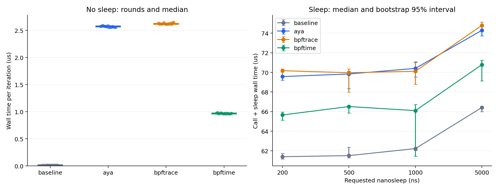
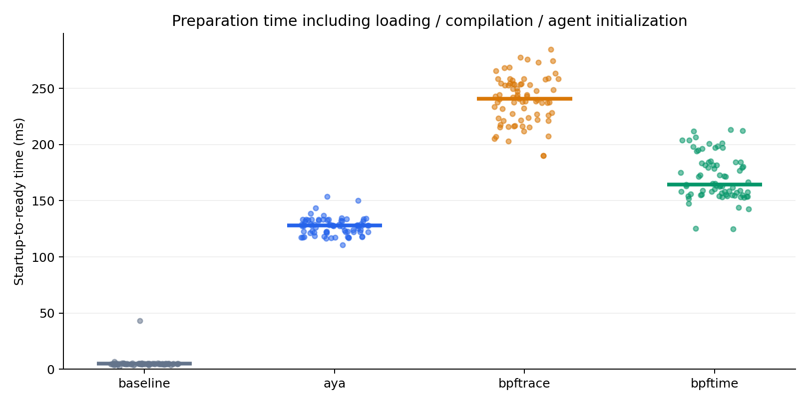

# uprobe 睡眠间隔与挂载准备耗时实验报告

数据批次：`sleep-formal-15rounds`。开始时间：2026-10-13T19:03:04+0800。本报告由原始日志和数据自动核验后生成；短测、之前中断的批次均未并入正式统计。

## 1. 核心结果

无 sleep 时，Aya、bpftrace、bpftime 的每次调用耗时中位数分别为 **2.572 μs、2.620 μs、0.967 μs**。bpftime 的吞吐量分别为两个内核方案的 **2.66 倍、2.71 倍**。

加入 nanosleep 后，应比较“调用 + 实际等待 + 调度”的总耗时，而不能将 `sleep_ns` 直接当作真实调用间隔。实际 baseline 如下，远大于请求的 200–5000 ns：

| 请求 sleep/ns | Aya 总耗时 / bpftime | bpftrace 总耗时 / bpftime | baseline 每轮迭代/μs |
| --- | ---: | ---: | ---: |
| 0 | 2.658 | 2.709 | 0.012 |
| 200 | 1.060 | 1.069 | 61.398 |
| 500 | 1.050 | 1.052 | 61.508 |
| 1000 | 1.065 | 1.061 | 62.227 |
| 5000 | 1.050 | 1.057 | 66.413 |

这些比值同时等于 bpftime 相对对应方案的吞吐量比。sleep 组接近 1 的比值表示总循环被等待成本主导，不表示三个探针自身开销完全相同。小差值必须结合下面的置信区间及波动看待。

本批次非零 sleep 组中，bpftime 相对两个内核方案的吞吐量优势约为 **5.0%–6.9%**，明显小于无 sleep 时的倍数优势。Aya 与 bpftrace 在请求 sleep 为 **200, 500, 1000, 5000 ns** 的组间差值区间跨过 0，这些组不宜给二者排出确定的高低名次。



左图每个点是一轮批量测量的均值，横线是各轮中位数；右图是中位数及 bootstrap 95% 区间。它们不是单次函数调用的 p50/p99 延迟。

## 2. 环境与实验设计

| 项目 | 记录 |
| --- | --- |
| CPU | Intel(R) Xeon(R) Gold 6126 CPU @ 2.60GHz |
| 内核 | 5.4.0-216-generic，x86_64 |
| 目标 CPU | 逻辑 CPU 0 |
| SMT 邻居 | 0,24 |
| governor | powersave |
| 内核 BPF JIT 开关 | 1 |
| Intel no_turbo | 0（0 表示未禁用 turbo） |
| 初始 loadavg | 5.92 5.17 4.97 3/13001 115686 |
| bpftrace | bpftrace v0.9.4 |
| Aya / aya-ebpf | 归档 Cargo.lock：0.14.0 / 0.2.1 |
| 轮数 | 每组合 15 轮，5 种间隔 × 4 方案，共 300 次有效测量 |
| 无 sleep | 测量 2,000,000 次，预热 200,000 次 |
| 非零 sleep | 每种测量 20,000 次，预热 2,000 次 |
| timer slack | [50000] ns，保留系统设置 |
| 随机顺序 | 每轮随机打乱 20 个组合，seed=20261013 |

测试未修改系统 governor、turbo 或调度策略；CPU 固定但未独占，也未隔离 SMT 邻居。环境仍可能受其他任务和动态频率影响。Rust 版本在 sudo 环境可能查不到，按 environment.json 的真实记录保留；已归档加载器、对象、bpftime 库的 SHA-256，但安装库的精确源码提交和实际 JIT 后端未得到独立确认。

目标 C 函数 `bench_add` 是禁止内联、禁止克隆的简单加法，包含 16 个 NOP 和编译器屏障，以保留真实调用和用户态 hook 所需指令空间。目标用 GCC -O2、禁用 LTO/PIE 构建。三组探针均对固定键计数，不在每次触发时输出日志。

- baseline 无探针；Aya 使用内核 uprobe 和 Rust per-CPU hash；bpftrace 使用内核 uprobe 与 `@hits[0] = count()`。
- bpftime 复用 bpftrace 的计数脚本，server 预加载到 tracer，agent 预加载到目标，在用户态执行 hook。每次试验使用独立共享内存名称。
- 非零 sleep 的每次迭代先调用函数，再请求一次 nanosleep；最后一次迭代也 sleep。EINTR 后继续等待剩余时间，零间隔完全不调用 nanosleep。
- 预热结束后，以 CLOCK_MONOTONIC_RAW 在整个循环前后计时；`elapsed_ns / iterations` 是一次迭代的摊销墙钟耗时。编译、加载、挂载、预热和退出清理均不在该区间内。
- 目标输出 BENCH 后保持存活，等待 tracer 读取计数并停止，再退出；等待发生在计时结束后，不增加报告中的循环耗时。

相比原来 7 轮，每组合增加到 15 轮；每轮正式调用和预热数也加倍。样本更多能帮助观察波动，但不消除系统性偏差。

## 3. 每种 sleep 的完整性能结果

单位为 μs/迭代。额外开销 = 本组中位数 − **相同 sleep 的 baseline 中位数**；没有用无 sleep baseline 去扣减睡眠组。

| 请求 sleep/ns | 方案 | 中位数/μs | 中位数 95% 区间/μs | 额外开销/μs | 批次变异系数 |
| --- | --- | ---: | ---: | ---: | ---: |
| 0 | baseline | 0.012 | [0.011, 0.012] | 0.000 | 9.69% |
| 0 | aya | 2.572 | [2.559, 2.576] | 2.560 | 0.43% |
| 0 | bpftrace | 2.620 | [2.616, 2.636] | 2.609 | 0.48% |
| 0 | bpftime | 0.967 | [0.963, 0.973] | 0.956 | 0.74% |
| 200 | baseline | 61.398 | [61.158, 61.732] | 0.000 | 3.12% |
| 200 | aya | 69.572 | [69.199, 69.634] | 8.174 | 2.35% |
| 200 | bpftrace | 70.174 | [69.509, 70.344] | 8.776 | 1.86% |
| 200 | bpftime | 65.655 | [65.129, 65.935] | 4.256 | 1.18% |
| 500 | baseline | 61.508 | [61.283, 62.360] | 0.000 | 3.30% |
| 500 | aya | 69.839 | [68.341, 70.128] | 8.330 | 1.79% |
| 500 | bpftrace | 69.965 | [67.982, 70.349] | 8.457 | 3.56% |
| 500 | bpftime | 66.515 | [65.849, 66.606] | 5.006 | 2.24% |
| 1000 | baseline | 62.227 | [62.041, 62.344] | 0.000 | 1.45% |
| 1000 | aya | 70.408 | [69.532, 71.087] | 8.181 | 3.39% |
| 1000 | bpftrace | 70.112 | [68.794, 71.004] | 7.886 | 2.75% |
| 1000 | bpftime | 66.099 | [61.449, 66.730] | 3.872 | 4.86% |
| 5000 | baseline | 66.413 | [65.992, 66.492] | 0.000 | 3.12% |
| 5000 | aya | 74.290 | [73.731, 74.841] | 7.877 | 1.99% |
| 5000 | bpftrace | 74.792 | [74.206, 75.135] | 8.379 | 2.80% |
| 5000 | bpftime | 70.784 | [69.126, 71.255] | 4.371 | 4.52% |

## 4. 差值的不确定性

下面直接对“组中位数 − baseline 中位数”给出区间，避免仅因两个中位数不同就断言探针更快或更慢。

| 请求 sleep/ns | 方案 | 差值/μs | 差值 95% 区间/μs |
| --- | --- | ---: | ---: |
| 0 | aya | 2.560 | [2.548, 2.565] |
| 0 | bpftrace | 2.609 | [2.605, 2.625] |
| 0 | bpftime | 0.956 | [0.952, 0.962] |
| 200 | aya | 8.174 | [7.762, 8.382] |
| 200 | bpftrace | 8.776 | [7.920, 9.072] |
| 200 | bpftime | 4.256 | [3.604, 4.689] |
| 500 | aya | 8.330 | [6.965, 8.604] |
| 500 | bpftrace | 8.457 | [6.516, 8.892] |
| 500 | bpftime | 5.006 | [4.155, 5.149] |
| 1000 | aya | 8.181 | [7.328, 8.743] |
| 1000 | bpftrace | 7.886 | [6.529, 8.897] |
| 1000 | bpftime | 3.872 | [-0.624, 4.688] |
| 5000 | aya | 7.877 | [7.352, 8.459] |
| 5000 | bpftrace | 8.379 | [7.684, 8.864] |
| 5000 | bpftime | 4.371 | [2.834, 4.906] |

方法：按轮号配对，重采样 15 个轮号 10,000 次；每次分别算该组与 baseline 的中位数并相减，取 2.5%/97.5% 分位点。中位数区间也采用同一组轮号重采样。随机种子为 20261013，详细统计保存在 [statistics.csv](statistics.csv)。

三个探针方案之间的直接差值如下，正值表示右边方案耗时更低；区间同样按轮号配对重采样：

| 请求 sleep/ns | 对比 | 中位数之差/μs | 差值 95% 区间/μs |
| --- | --- | ---: | ---: |
| 0 | bpftrace − aya | 0.049 | [0.042, 0.065] |
| 0 | aya − bpftime | 1.604 | [1.592, 1.611] |
| 0 | bpftrace − bpftime | 1.653 | [1.644, 1.669] |
| 200 | bpftrace − aya | 0.602 | [-0.135, 0.993] |
| 200 | aya − bpftime | 3.917 | [3.425, 4.463] |
| 200 | bpftrace − bpftime | 4.519 | [3.574, 5.047] |
| 500 | bpftrace − aya | 0.127 | [-1.857, 1.387] |
| 500 | aya − bpftime | 3.324 | [2.374, 4.045] |
| 500 | bpftrace − bpftime | 3.451 | [1.808, 4.215] |
| 1000 | bpftrace − aya | -0.295 | [-1.676, 0.568] |
| 1000 | aya − bpftime | 4.309 | [3.109, 8.958] |
| 1000 | bpftrace − bpftime | 4.014 | [2.070, 8.588] |
| 5000 | bpftrace − aya | 0.502 | [-0.434, 1.234] |
| 5000 | aya − bpftime | 3.506 | [2.869, 4.927] |
| 5000 | bpftrace − bpftime | 4.008 | [3.359, 4.440] |

这是有限样本的 percentile bootstrap 近似，没有做多重比较校正，且假设轮次近似可交换；随机顺序不能保证相邻轮次完全独立。区间跨 0 的差值不应下确定性结论。睡眠组的差值包含探针对唤醒、CPU 频率、缓存和调度状态的间接影响，不能直接称为纯 uprobe 执行成本。

## 5. 挂载相关耗时

三方统一可观察的是**启动到可测试的准备流程**。不把它冒充纯 attach API 时延。

1. tracer-startup-ready：启动 tracer 前至 runner 观察到就绪，包含进程启动、加载、bpftrace 编译及检查延迟。bpftime 用 bpftimetool 检查共享内存。
2. target-startup-ready：启动目标前至目标 main 中的 CLOCK_MONOTONIC 时间戳，包含进程创建、affinity、动态链接；bpftime 还包含 agent 初始化、JIT/hook 安装。
3. total-ready：上述两项逐样本相加，排除人为等待的 0.2 秒、预热和测量。baseline 仅包含目标启动。

各 sleep 组执行的准备操作相同，下面合并每方案 75 个样本描述其分布；各 sleep 分组数据仍在原始 attach_summary.csv 中。这不是独立的冷启动实验，缓存和机器状态随运行变化。

| 方案 | 样本数 | tracer-ready 中位数/ms | target-ready 中位数/ms | total-ready 中位数/ms | total-ready 范围/ms |
| --- | ---: | ---: | ---: | ---: | ---: |
| baseline | 75 | 0.000 | 4.831 | 4.831 | 2.471–43.111 |
| aya | 75 | 122.410 | 5.461 | 127.853 | 110.797–153.587 |
| bpftrace | 75 | 234.753 | 5.374 | 240.858 | 190.274–284.728 |
| bpftime | 75 | 125.910 | 37.095 | 164.442 | 124.726–213.112 |

中位数不满足可加性，所以表中两个分量的中位数之和可能不等于 total 中位数。



Aya 额外在 `UProbe::attach` 调用周围直接计时：中位数 **35.669 ms**，范围 **23.698–61.875 ms**，包括符号解析和 attach API 内部操作、不包括前面的对象/程序加载。bpftrace 和 bpftime 没有同口径的独立 attach API 时间，故不能拿此值与它们的 total-ready 排名。

tracer 就绪轮询间隔为 5 ms；bpftrace READY 受异步输出影响，bpftime 导出还需启动检查工具。这些观察开销不相同，足以影响毫秒级排名。target-ready 终点取自目标内部时间戳，不采用日志读到的时刻。以上所有准备时间均不是精确测得的内核 attach syscall 成本。

## 6. 为什么存在这些差异

**无 sleep 时，内核触发路径通常是主要差异来源。** Aya 和 bpftrace 都通过内核 uprobe 执行探针，需要断点异常处理、上下文处理、执行 BPF/Map 操作并恢复目标指令；这不意味着每次都调度切换到另一个进程。bpftime 使用进程内二进制重写 hook，避免每次走内核 uprobe 的陷入路径。这个机制与观察到的性能差异相符，但没有 profile，不能把全部差值或某个固定纳秒数归因于用户态/内核态转换。[Linux 5.4 uprobes 源码](https://github.com/torvalds/linux/blob/v5.4/kernel/events/uprobes.c)、[bpftime 设计说明](https://eunomia.dev/bpftime/documents/how-it-works/)

**sleep 后，等待与唤醒成本占据更大的比重。** nanosleep 的参数虽以 ns 表示，却不保证严格按请求值恢复执行。定时器粒度、timer slack 和任务重新获得 CPU 都会延长墙钟等待；本次 timer slack 已实测归档。因此 200 ns 和 500 ns 两组实际耗时接近、甚至受噪声影响发生顺序交叉，都不能证明 sleep API 精确到了这个分辨率。[nanosleep 手册](https://man7.org/linux/man-pages/man2/nanosleep.2.html)、[timer slack 手册](https://man7.org/linux/man-pages/man2/PR_SET_TIMERSLACK.2const.html)

**Aya 与 bpftrace 的细小差异需要谨慎归因。** 它们共享内核探针路径，但生成的指令与 Map 更新实现未保证完全相同；编译器、加载器细节和系统状态都可能产生差异。加载器使用 Rust 或 C++ 并不能直接解释热循环的差值，bpftrace 也不是每次命中都解释一遍脚本。

**睡眠组的额外差值可能比无 sleep 更大。** 每次睡眠使线程离开连续热循环，CPU 频率、空闲状态、缓存温度和重新调度都会变化。探针会改变 sleep 被请求的时间点，进而影响下一次唤醒；因此“带探针睡眠组 − baseline 睡眠组”并不保证等于连续热循环中测得的探针成本。报告保留这些真实差值，但没有硬件计数器或调度轨迹，不能将增量具体归因于某一种机制。

**准备时间与触发成本是不同指标。** bpftrace 的编译/加载、bpftime agent 的初始化/JIT/hook 都主要发生在开始阶段，热循环快不代表准备也最快。准备时间在真实应用中通常被后续许多次调用摊销。

## 7. 正确性、退出稳定性与限制

已逐项核对全部 300 个有效样本的 target 日志、checksum、计时和配置；全部 225 个探针样本最终计数等于 iterations + warmup。缺失或错误计数不会被当作性能结果。

- 正式批次失败尝试数：**0**；有效样本中重试后成功的数量：**0**。失败记录保留在 raw.json，不计入统计。
- 有效样本中需要重发 SIGINT 的数量：**1**，最多发送 **2** 次。这个动作只发生在计时结束后。
- tracer 日志中包含 perf-event 关闭警告的有效样本：**75**。计数仍正确且进程返回码通过 runner 校验，但不能据此声称 bpftime 的生命周期兼容性没有问题。
- 之前中断批次的目标虽然完成计时，但没有最终计数，不能事后恢复成有效探针样本；本报告没有使用它们。

无 sleep baseline 的单轮计时长度范围为 **15.83–24.89 ms**，仍比探针组短；对应基线倍率容易受频率和调度变化影响。更多轮次提升了分布观察，但没有将所有负载变成相同持续时间。全实验也没有覆盖多线程、多键 Map、真实业务函数、参数采集、堆栈、事件传输或 uretprobe。

不能把本次速度倍数推导为应用整体加速。实际收益取决于探针调用频率、业务本身耗时、并发和等待比例。

## 8. 复现与证据

```bash
sudo python3 bench/run.py \
  --modes baseline,aya,bpftrace,bpftime \
  --bpftime-server /home/wangyiwei/.bpftime/libbpftime-syscall-server.so \
  --bpftime-agent /home/wangyiwei/.bpftime/libbpftime-agent.so \
  --bpftimetool /home/wangyiwei/.bpftime/bpftimetool \
  --sleep-ns 0,200,500,1000,5000 \
  --iterations 2000000 --warmup 200000 \
  --sleep-iterations 20000 --sleep-warmup 2000 \
  --rounds 15 --cpu 0 --seed 20261013 \
  --timeout 300 --shutdown-timeout 30 --shutdown-retries 2
```

- [全部原始结果](../../results/sleep-formal-15rounds/raw.json)、[性能汇总](../../results/sleep-formal-15rounds/summary.csv)、[准备耗时汇总](../../results/sleep-formal-15rounds/attach_summary.csv)。
- [环境、二进制哈希和配置](../../results/sleep-formal-15rounds/environment.json)、[运行时源码快照](../../results/sleep-formal-15rounds/source/)。
- [统计明细](statistics.csv)、[耗时图 PDF](latency.pdf)、[准备耗时图 PDF](setup.pdf)。
- 生成报告：`bench/.analysis-venv/bin/python bench/analyze_sleep.py /data/wyw/study/ayatest/bench/results/sleep-formal-15rounds`。
